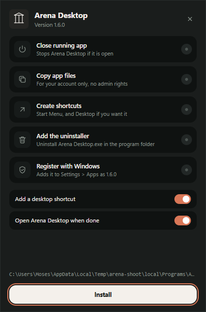
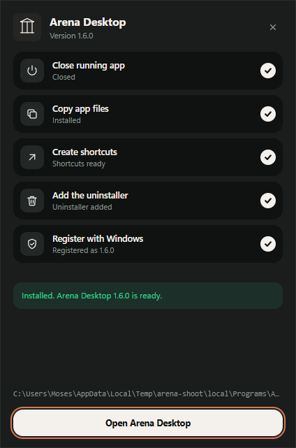
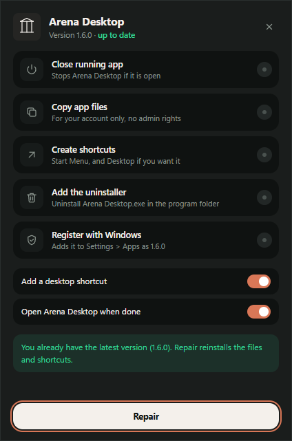
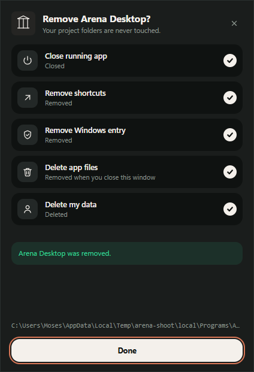
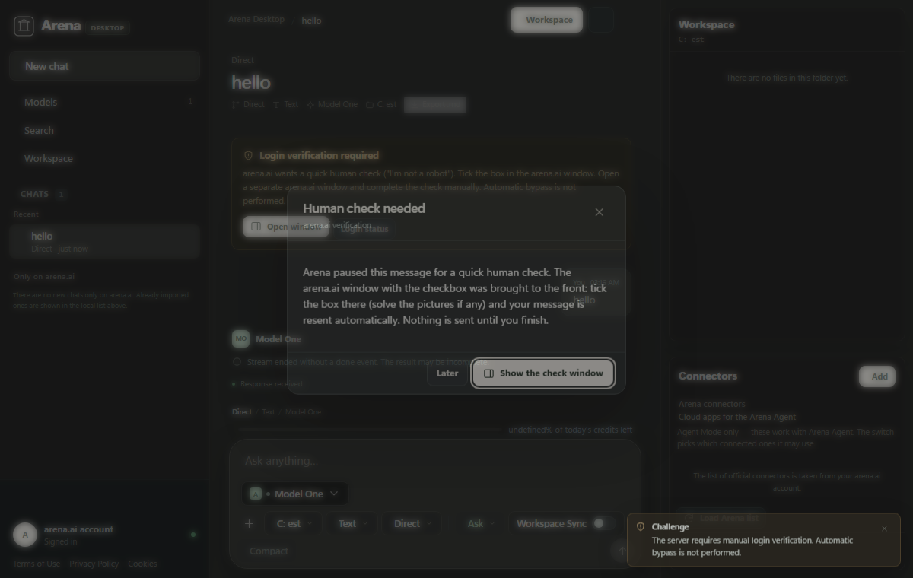

<p align="center">
  
</p>

<h1 align="center">Arena Desktop</h1>

<p align="center">
  <b>An unofficial desktop app for <a href="https://arena.ai">arena.ai</a> — chat, battles, a real Agent Mode,
  and models that can work on the files on your machine, all in one window.</b>
</p>

<div align="center">
  <a href="https://github.com/PlayzAe/arena.ai-desktop/stargazers"></a>
  <a href="https://github.com/PlayzAe/arena.ai-desktop/releases/latest"></a>
  
  
  
  <a href="LICENSE"></a>
</div>

<p align="center">
  
</p>

> [!IMPORTANT]
> Arena Desktop is an **unofficial, community-built client**. It is not affiliated with or endorsed by Arena AI Inc.
> You sign in with your own arena.ai account and are responsible for following arena.ai's terms.
> The app never solves human checks for you — when arena.ai asks for one, you complete it yourself.

---

## Contents

- [Download](#download)
- [What's new in v1.6.0](#whats-new-in-v160)
- [What's new in v1.5.0](#whats-new-in-v150)
- [What it does](#what-it-does)
- [How it works](#how-it-works)
- [Repository layout](#repository-layout)
- [Run from source](#run-from-source)
- [Tests](#tests)
- [Troubleshooting](#troubleshooting)
- [Limitations](#limitations)
- [Roadmap: macOS and Linux](#roadmap-macos-and-linux)
- [Translations](#translations)

## What's new in v1.6.0

### After the first 1.6.0 builds: fixes from real use
- **Dropped streams no longer lose the project.** After every Code turn the app asks Arena for the finished project (`/api/evaluation/webdev/<message id>`: every text file with its final content, the image names and the live site link) and brings your folder up to date. This is what fixes "Ready to build" showing locally while the real site was built on Arena.
- **Generated images are fetched while the sandbox still serves them**, as soon as `generate_image` finishes. After Arena deploys, it answers 404 for `/images/...`; the app then tells you which images it could not get instead of failing silently.
- **No more white "Local preview" box in Code mode.** The final `arena.site` link is kept per chat (it survives leaving and coming back). Arena forbids framing that site (`X-Frame-Options: SAMEORIGIN`), so **Preview** opens it in an app window and **Browser** in your browser.
- **Usage meter shows Arena's real number.** It reads Arena's daily-credit meter (`/api/me/pulse`): "N% of today's credits left", when they refresh, and a "Daily limit reached" state. The old bar guessed a percentage and could show 82% on a fresh install.
- **Project files panel and a file editor for Code dialogs.** Code chats now show a collapsible "Project files" tree of the chat's folder above the composer (it refreshes while the sandbox works), and any text file opens in the preview modal with an Edit/Save editor. Saves stay inside the chat's panel folder and are guarded against traversal, sensitive paths, binary content and oversized files.
- **Missing folder:** if the chosen folder was deleted, you get a clear message to pick another one. New installs default to `Documents\Arena Desktop`.

### About Arena's new daily limit
Arena added a daily credit limit to something that used to be free. Per [Arena's own help page](https://help.arena.ai/articles/3295820808-arena-troubleshooting-daily-usage-limits?lang=en), it is one pool of credits for every feature, your 24 hours start at your first prompt, and it resets after 24 hours. Arena staff have also said that failed generations count as usage. People report hitting the wall after two or three prompts, Battle mode included. Arena is going to lose its fans over this, and this app can do nothing about it: it will not bypass, hide or reset the limit. It only shows Arena's own meter and tells you when the credits are gone and when they come back.

### Code mode saves the whole project
- Arena's starter files (`package.json`, `tsconfig.json`, `vite.config.ts`, `index.html`, `src/main.tsx`, `src/App.tsx`, `src/utils/cn.ts`) are saved next to the files the AI writes, in one folder.
- Images saved under `public/` are downloaded. `cp`, `mv` and `mkdir` from the sandbox are repeated locally.
- `npm install` runs on your PC (automatic in Accept edits and Bypass permissions, asks in other modes, never in Plan mode). Use **Run on this PC** to start the dev server and **Stop** to end it.
- Your own files are never overwritten by Arena's starter files.
- Project files you name in your message (for example an existing `kimi-k3.txt`) are sent to the AI with the message, so it edits your file instead of creating a new one.

### Install and update in one click

<p align="center">
  
  
  
</p>
<p align="center">
  
  
</p>

- **Setup** installs `Arena-Desktop.exe` and an own **`Uninstall Arena Desktop.exe`** into `%LOCALAPPDATA%\Programs\Arena Desktop`. Running Setup again says "You already have the latest version" (Repair) or offers the update.
- **Uninstall** removes the app, shortcuts, the Settings > Apps entry and, if you leave the box ticked, your chats, settings and saved sign-ins. Code you generated (your project folders) is never deleted.
- **Human check:** when arena.ai shows its "I'm not a robot" box, Arena Desktop pauses the message, brings the arena.ai window forward and resends after you tick it. It never solves the check itself.

- `Arena-Desktop-Setup.exe` installs for your account (Start Menu and optional Desktop shortcut, entry in Settings > Apps, no admin rights).
- When a newer version is released, **Update now** downloads it with a progress bar, checks its SHA-256, closes the app, installs it, reopens it and shows what is new.
- Uninstall can also delete your chats, settings and saved sign-ins. Project folders are never touched.

### Connectors and MCP
- HTTP MCP servers connect (JSON or SSE replies, session ids, custom headers).
- Arena connector sign-in opens your default browser and closes itself when it worked.

### Interface
- Claude Code–style tool rows: orange `✻` while working, green `●` steps with a `⎿` summary, white `●` for the answer.
- Usage shows each Arena limit separately: Chat / Code / Direct / Battle and Agent, with remaining count and reset time.

### Build from source
```powershell
python scripts/build.py                 # builds dist/release/ (exe, installer, .sha256)
python scripts/build.py --bump patch    # raise the version first (patch | minor | major)
```
The version lives only in `arena/__init__.py`.

## What's new in v1.5.0

### Reliability fixes (after 1.5.0)

- **Chats stay apart.** A reply keeps the folder it started in, opening a chat switches back to its folder, and an approval request shows only in its own chat.
- **No double sends.** When the connection drops after arena.ai took a message, the app reads the reply from arena.ai's copy of the chat instead of sending the prompt again. Sending twice used up arena.ai's per-chat token limit.
- **Clear errors.** A full arena.ai session, an "I'm not a robot" check and an arena.ai outage (from status.arena.ai) are named as such. Text chats continue in a fresh session when one fills up.
- **Run on this PC.** The ▶ button in the Workspace panel installs a Code-mode project's packages, starts its dev server, shows the address and stops it on request. Dev servers the agent starts show their address in the chat.
- Cleaner text between tool steps, and Refresh from Arena fixes replies that were cut off or glued together.
- **Account menu.** The menu shows who is signed in, then the saved accounts to switch to. Switching, signing out and signing in with cookies show each step as it happens.
- **Old chats read like new ones.** Chats from before 1.5 show their tool calls as rows with their output, instead of raw tags, and Code-mode steps keep their output.
- **Chats stay in place.** Opening or importing a chat no longer moves it to the top of the list.
- **Previews open in the app.** The Preview button on a live site opens the app's preview window. Before, an error sent it to the web browser instead. Closing the window only hides it.
- **arena.ai outages are shown.** The app reads status.arena.ai. When arena.ai reports trouble, a bar at the top names the problem and links to the status page. While arena.ai fails, the sign-in check no longer says your session expired. Settings → About → Quick diagnostics has a new "Arena.ai service status" row, and failed checks now show why. The encryption check no longer always fails.

### Arena Agent files land on your computer

With Workspace Sync on, every file the Arena Agent writes, edits or deletes in arena.ai's cloud workspace is copied into your chosen folder as it happens. This covers its file tools and `cat > file << 'EOF'` heredocs in shell commands. It asks once per chat, follows the permission mode, and never overwrites or deletes a file you changed on this computer. Dependency folders (`node_modules`, `.git`) are skipped. An HTML file it saves gets a live local preview.

### Site previews

Preview links are now `/preview/<key>/index.html`, using a read-only key separate from the API token. Linked CSS, JS and images load too, and "Open preview" no longer ends in `Missing or invalid API token`. arena.site links from Arena (Code mode and Agent) show as a "Live site" card with Preview, Copy link and Browser. In the desktop app, Preview opens its own WebView2 window: arena.site pages refuse to load inside frames, so an in-page iframe cannot show them.

### Smaller fixes

- Opening a chat no longer pulls Arena's copy of your injected memory, tool guide and tool results into it. Those used to show up as extra turns, so chats looked mixed together. Opening a chat no longer moves it to the top of the list.
- Cold start shows "Connecting to arena.ai…" with your saved account, then loads history and models by itself. You no longer need to refresh.
- Chat titles Arena copied from the injected guide ("[Arena Desktop] The user is…", "[System] You are Arena CLI…") are replaced by a summary of your first message.
- The first-run setup checks your account against the Direct model list. Battle mode has no model list, so the old check was wrong.
- Connectors: Arena connectors and local MCP servers are separate groups, and `mcp.json` sits next to the local group.
- The message jump control stays inside the chat column and no longer duplicates "back to bottom".
- Tests run against a temporary config folder (`ARENA_CONFIG_DIR`). They used to add fake accounts to the real `~/.arena-personal`.

### Claude Code–style tool rows

Agent tool calls render as compact terminal rows instead of boxed cards: `● Bash(npm install && npm run build)` with the result underneath (`⎿ added 214 packages…`). Green dot = done, red = failed (with the exit code), amber = waiting for your approval, blinking = running. Long output folds to 4 lines with "+N lines (click to expand)"; reads, listings and searches show a one-line summary ("Read 120 lines", "Found 8 matches"); edits show a coloured diff. Arena Agent's JSON tool input/output (`{"command": …}`, `{stdout, exitCode}`) is unwrapped into the same format. The header status reads `✻ Running command… 12s` / `✻ Thinking… 3s`, and the tool input and output are now saved in chat history, so reopened chats keep them.

### Run npm / cmd commands on your computer

In Agent mode with a local folder, `run_cmd` now supports full shell syntax through `cmd.exe` (or `/bin/sh`): `npm install && npm run build`, pipes, redirects and `%VAR%`. Output streams live into the tool row while the command runs, and Stop kills the whole process tree. Dev servers and watchers can run in the background (`<background>true</background>`): the agent gets the first output and the local URL, the process keeps running, and `stop_cmd` (or closing the app) ends it. Package managers and builds get a 180 s silence limit instead of 30 s.

Safety: a command that uses shell syntax or inline code (`-c`, `-e`, `--eval`) is never auto-approved. You confirm each one, even after "Allow such actions in this session" and in every permission mode. Catastrophic commands stay blocked.

### Usage bar

Live usage indicator above the composer shows how much of your daily arena.ai limit is used. Piggybacks on ratelimit headers — zero extra API calls. Three color states: blue (normal), amber (70%+), red (90%+). Reset countdown shows when limits refresh.

### Typewriter loading phrases

The typewriter animation ("asking Terry", "beam searching", etc.) now reliably shows during the loading window before text arrives, with a minimum 1.8s display window to prevent flicker. The animation used to stop before typing a single letter (it checked that it was on the page before it had been attached); it now survives the chat re-rendering on every stream event.

### Modular JS codebase

`app.js` split from one 11,316-line file into 14 source modules in `js/`, each under 1,500 lines. Concatenated into `app.js` by `python scripts/build-js.py`. Same IIFE, zero runtime change. Only the frontend is split so far: the backend `arena/web/app.py` (about 8,000 lines: Flask routes, chat and agent loops, the Arena Agent stream, uploads, workspace) is still one module, and splitting it into smaller files is planned for the next release.

### Previous: v1.4.0

<details>
<summary>What was new in v1.4.0</summary>

- Shell builtins (`echo`, `dir`, `ver`) now work in the terminal
- 8 security findings patched from a full code audit
- 46 feature tests + 22 security verification tests all pass
- **CRITICAL:** Settings import filtered — crafted settings files can no longer inject `permission_mode` or `gateway_auto`
- **HIGH:** Upload and workspace panel block sensitive dirs (`.git/`, `.ssh/`, `.env/`)
- **MEDIUM:** SSRF hardened, terminal scoped to workspace, agent symlink check added
- **LOW:** Error messages sanitized

</details>

### Previous: v1.3.0

<details>
<summary>What was new in v1.3.0</summary>

- **Workspace file reading** — AI models can read, list, browse files in workspace
- **Typewriter loading animation** — 30 random phrases with typing/erasing effect
- **Rate limit reference** — all 8 known arena.ai rate limits documented in Settings
- **Chat replay fixed** — system prompts filtered from visible messages
- **Send button arrow** — missing CSS class fixed
- **About dialog logo** — colosseum logo instead of star
- Upload endpoint unblocked, caps enforced, null bytes stripped, preview CSP updated

</details>

### Previous security work (v1.2.0-alpha → beta, carried forward)

<details>
<summary>22 findings fixed in v1.2.0</summary>

- `/api/token` removed — secret injected via `<meta>` tag instead
- DPAPI encryption for cookies and credentials (Windows; other platforms planned)
- Agent sandbox blocks `.ssh`, `.aws`, `.gnupg`, `.env`, `.git`, NTFS ADS, symlink escapes
- `contracts.json` locked to existing API path keys only
- SVG data-URI XSS blocked (raster-only)
- "Always allow" resets per chat
- Automations locked to plan mode
- Per-launch API token on all `/api/*` endpoints
- Workspace scoped to projects directory
- Settings allowlist
- Inline code blocking on agent commands
- `shell=False` on all subprocess calls
- `/api/terminal` hardened — `shell=False`, `shlex.split`, 30s timeout, workspace-scoped, token-gated
- Security headers on index and static routes

</details>

> [!NOTE]
> Report issues on the [issues page](https://github.com/PlayzAe/arena.ai-desktop/issues).

## Download

Every build is on the [releases page](https://github.com/PlayzAe/arena.ai-desktop/releases/latest).

| Platform | Download | Notes |
| --- | --- | --- |
| Windows 10 / 11 | `Arena-Desktop-Setup.exe` | Installer with shortcuts and one-click updates. Requires Edge WebView2 (built into Windows 11). |
| Windows 10 / 11 | `Arena-Desktop.exe` | Portable single file. The in-app updater downloads this one. |

If Windows SmartScreen warns: click **More info → Run anyway** (the EXE is not code-signed).

## What it does

- **Every arena mode in-app** — I built in Battle, Side by Side, Direct, and Agent Mode so you don't need a browser tab.
- **Every modality** — Text, Image, Web Search, Code, Video, Auto (same rules as the website).
- **Workspace Sync** — models can list, read, write, edit files and run commands in a folder you choose, under a permission mode you control.
- **Files land on your PC** — files the Arena Agent writes in its cloud sandbox are copied into your folder as it works, and `arena.site` links open in an in-app preview.
- **MCP servers + Arena connectors** — local MCP servers (presets, JSON, CLI) and official Arena connectors with per-connector toggles.
- **Multi-account** — switch arena.ai accounts in one click, parallel chats, local + cloud history.
- **Agent Gateway** — the genuine Arena Agent can use your local MCP servers and workspace folder through a pairing-protected tunnel.
- **Sub-agents, plan approval, memory, automations, compact context, undo.**

<table>
  <tr>
    <td width="50%"><br /><sub><b>Agent Mode</b>: Claude Code–style tool rows with live command output, diffs and failures.</sub></td>
    <td width="50%"><br /><sub><b>Answers</b>: code blocks with copy buttons, and a plain note of each permission decision.</sub></td>
  </tr>
  <tr>
    <td width="50%"><br /><sub><b>Battle Mode</b>: two anonymous models answer, then you vote.</sub></td>
    <td width="50%"><br /><sub><b>Workspace panel</b>: your folder's files, with Arena connectors and local MCP servers kept apart.</sub></td>
  </tr>
</table>

## How it works

```
┌──────────────── Arena Desktop (pywebview / WebView2) ────────────────┐
│  Single-page UI  ──►  local Flask API + SSE streaming  (arena/web/)  │
│                              │                                       │
│        ┌─────────────────────┼──────────────────────┐                │
│        ▼                     ▼                      ▼                │
│  arena.ai engine      native Arena Agent     local tool loop         │
│  (hidden window,      (agentic API,          (arena/agent.py +       │
│   real account)        resumable)             MCP connectors)        │
└──────────────────────────────────────────────────────────────────────┘
```

| Module | Role |
| --- | --- |
| `arena/desktop.py` | Native window shell (pywebview + WebView2) |
| `arena/web/app.py` | Flask API, SSE streaming, chat orchestration, accounts |
| `arena/web/static/` | The whole UI (HTML/CSS/JS) |
| `arena/web/static/js/` | JS source modules (14 files, each <1500 lines) |
| `scripts/build-js.py` | Concatenates js/ parts into app.js |
| `arena/engine.py` | Hidden arena.ai window for signed-in requests |
| `arena/native_agent.py` | Native Arena Agent protocol |
| `arena/agent.py` | Local tool loop: parsing, execution, permissions |
| `arena/connectors.py` | Local MCP server manager |
| `arena/permissions.py` | Permission modes and per-chat approval broker |

## Repository layout

```
Arena-Desktop/
├── arena/                  # application package
│   ├── web/                # Flask backend + static UI
│   └── tools/  ui/         # CLI-era tools and terminal UI
├── assets/                 # icon and logos
├── docs/                   # screenshots
├── scripts/                # build verification
├── tests/                  # pytest suites (unit/API + browser UI)
├── arena-cli.spec          # PyInstaller spec → Arena-Desktop.exe
├── requirements.txt
├── START_ARENA_DESKTOP.bat # one-click source launcher
├── KNOWN_ISSUES.md
├── HANDOFF.md
└── SECURITY_AUDIT.md
```

## Run from source

1. Install **Python 3.11+** and the Edge WebView2 Runtime.
2. Double-click **`START_ARENA_DESKTOP.bat`** — creates `.venv`, installs deps, opens the app.

Or manually:

```powershell
py -3 -m venv .venv
.\.venv\Scripts\python.exe -m pip install -r requirements.txt
.\.venv\Scripts\python.exe -m arena.desktop
```

## Tests

```powershell
.\.venv\Scripts\python.exe -m pytest tests --ignore=tests/test_ui_browser.py   # unit/API
$env:RUN_BROWSER_TESTS=1; .\.venv\Scripts\python.exe -m pytest tests/test_ui_browser.py  # UI (demo mode)
```

The UI tests need `pip install playwright` and `python -m playwright install chromium` once.

## Troubleshooting

- **SmartScreen warning**: click More info → Run anyway.
- **429 rate limit**: arena.ai's daily/per-modality cap, not the app. I show you which limit hit and when it resets.
- **Human check popup**: complete it manually in the Arena window.
- **Logs**: `%USERPROFILE%\.arena-personal\desktop.log`

## Roadmap: macOS and Linux

Arena Desktop is Windows-only right now because it depends on WebView2. I want to bring it to macOS and Linux — the backend (Flask + SSE) is platform-agnostic, so the main work is swapping the pywebview/WebView2 shell for something cross-platform (e.g. webview bindings for GTK/Cocoa, or an Electron shell). The DPAPI encryption layer would also need a platform-specific backend (Keychain on macOS, Secret Service on Linux).

An independent researcher already did a thorough code review and started building a separate Linux client (Wayland/KDE, Native Messaging + browser extension). Their security audit helped shape several of the v1.2.0-beta fixes. I don't have their contact info but want to publicly thank them for the work — if you're reading this, reach out so I can credit you properly.

If you're interested in helping with a port, PRs are welcome. The architecture section above shows what needs to change.

## Limitations

- **Windows only** — WebView2 dependency. macOS and Linux are on the roadmap.
- **Arena's limits apply** — daily caps, rate limits, new-account video gate. The app shows you which limit hit and when it resets, but I can't lift them.
- **Human checks stay manual** by design.
- **Code mode uses arena's sandbox**, not your machine. See [KNOWN_ISSUES.md](KNOWN_ISSUES.md).
- **Not code-signed** — SmartScreen will warn on first run.

## Why Arena probably won't ship an official desktop app

Based on Arena's [Terms of Use](https://help.arena.ai/articles/5629909088-terms-of-use) (last updated February 2026):

**Do they sell your data?** Not directly, but close. Section 3.3 grants Arena a perpetual, irrevocable, worldwide, sublicensable license to use everything you type — inputs and outputs — for "marketing and promotional purposes" and to "develop, enhance, evolve and improve" their products. Section 3.4 adds that your content goes to third-party AI providers who "may not be required to maintain the confidentiality" of it. Your conversations are training data.

**Five reasons an official desktop client is unlikely:**

1. **They're a benchmarking platform, not a productivity tool.** Arena exists to compare AI models side by side and collect votes for their leaderboard (§1). A desktop app built for daily use would compete with their own AI provider partners.

2. **They need your data on their servers.** The perpetual, sublicensable license to Your Content (§3.3) — including for labeling, training, and marketing — depends on server-side collection. A desktop client that caches locally or skips telemetry would undermine their data pipeline.

3. **They don't control the AI services.** Section 10.1.3 disclaims all responsibility for AI output, operation, and security. They're a routing layer, not a provider. Maintaining native desktop code for 400+ models they don't own is high cost with no revenue upside.

4. **The service is free with no business model yet.** Section 8: "Company currently offers the Service free of charge." No revenue means no budget for desktop engineering, testing, code signing, or platform-specific support.

5. **Their TOS bans programmatic access.** Section 5(vi) prohibits accessing "the Services through programmatic or automated means." They want you on the website where they control the experience, collect votes, and track usage.

This is why community clients like this one exist.

### Is this project violating Arena's TOS?

No. Arena Desktop does **not** violate Arena's Terms of Use:

- **No programmatic or automated access (§5(vi)).** Arena Desktop embeds the actual arena.ai website inside a WebView2 browser window. It does not scrape APIs, auto-query models, or bypass any endpoint. Every request goes through the same web interface a normal browser uses.
- **No leaderboard manipulation (§5(ii)).** The app does not submit votes, influence rankings, or interact with the leaderboard in any automated way. You vote manually, same as on the website.
- **No bot or crawler activity (§5(vii)).** There is no scraping, spidering, or automated data extraction. The app renders the same pages your browser would.
- **Human checks stay manual by design.** When arena.ai presents a CAPTCHA or verification, you complete it yourself in the embedded window. The app never solves or bypasses these.
- **Your account, your responsibility (§2.4).** You sign in with your own arena.ai credentials. The app adds local tools on top (workspace sync, MCP servers, multi-account switching) but never modifies what arena.ai sees or sends on your behalf beyond what you initiate.

Arena Desktop is a browser wrapper with local developer tools — the same class of software as any Electron-based web app. The TOS targets bots, scrapers, and vote manipulators, not desktop clients that render the website as-is.

## Translations

The UI is English-only right now. I'd love help translating it to other languages — if you're interested, open a PR or reach out on Discord. Priority languages: Spanish, Portuguese, Chinese, Japanese, Korean, French, German, Russian, Arabic and Hindi, but any language is welcome.

## Credits & license

Built by [PlayzAe](https://github.com/PlayzAe) and contributors. Major contributions from [Maxusimlive](https://github.com/Maxusimlive) on the desktop UI, chat system, workspace features and native Arena Agent integration. Thanks to the anonymous Linux researcher whose independent security audit shaped several of the v1.2.0-beta security fixes.

Released under the [MIT License](LICENSE). Not affiliated with Arena AI Inc.

## Contact

[](https://discord.com)

DMs open — `@playzae`. For bugs and features: [GitHub Issues](../../issues).

[](https://app.repohistory.com/star-history)
